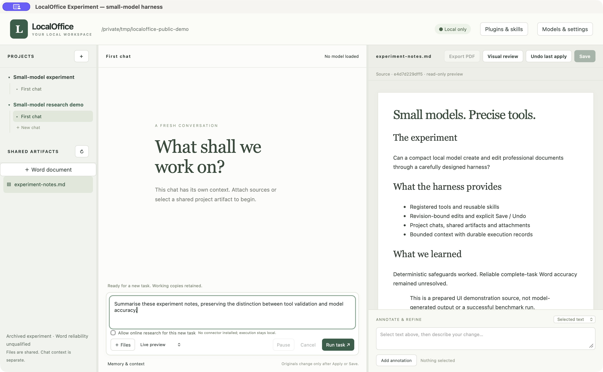
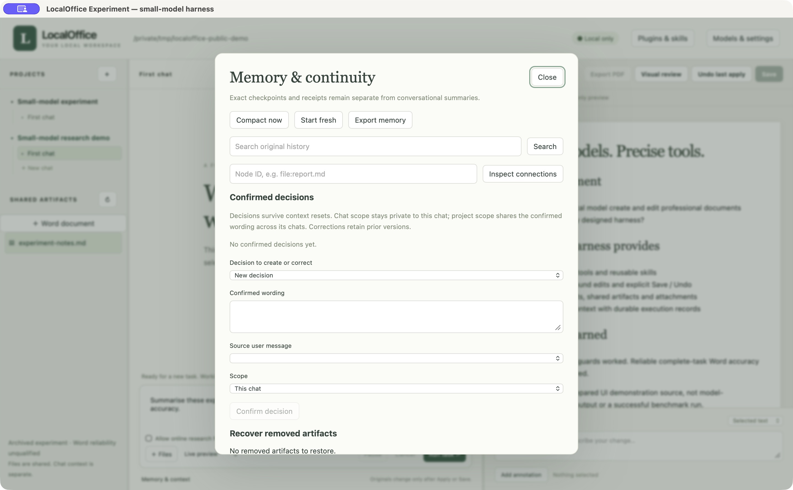
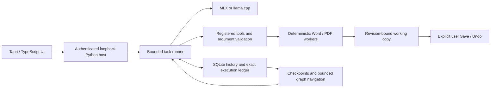

# LocalOffice: a small-model harness experiment

**26 hours, 28 minutes of recorded goal runtime with GPT-6 Astra running in Codex—the coding-agent harness used for development—to explore one question: can a carefully designed harness make a small local model reliable at precise document work?**

**This is an unfinished experiment, not a production Office assistant.** We are publishing the client, source, failure/success logs and lessons so others can reproduce the tests and reuse the useful parts. The duration is the goal system's recorded runtime (95,306 seconds), not continuous inference, engineering labour or total project age. See [timing provenance](docs/results/README.md#development-duration).

## The problem

Small local models are attractive for private, affordable document work, but precise editing requires more than fluent text. The model must preserve exact quotations, generate new prose with constraints, choose valid operations, target the right objects, respect formatting, recover from errors and know when to stop—all within limited context and memory.

Our target was a 16 GB Apple-silicon Mac with a quantized 3–4B model. Actual validation used a **24 GiB development Mac**; physical 16 GB performance was never qualified. A wrong tool call or apparently minor omission can invalidate the whole document task.

## The attempted solution

Move mechanical work into an explicit, auditable harness:

1. **Model chooses; tools execute.** Registered tools and lazily loaded skills replace routine model-written scripts and XML. Deterministic workers perform document operations.
2. **Constrain and validate calls.** Native model templates, constrained decoding, state-bound arguments, schema validation and bounded retries reduce invalid execution.
3. **Make edits precise and reviewable.** Revision-bound patches, working copies, rendered previews, annotations, explicit Save and Undo protect original files.
4. **Manage narrow context.** Durable history, exact execution receipts, checkpoints and bounded graph retrieval support continuation without resending unchanged documents.
5. **Measure the complete task.** Count total calls, retries, tokens, latency and memory; assess meaning, artifact structure, rendered layout and the save/undo lifecycle separately.

The working prototype uses a Tauri/TypeScript desktop client, Python host, MLX/llama.cpp adapters and an Open XML Word worker. The final Word experiments pin **Qwen3-4B-Instruct-2507, MLX 4-bit**, with a 4096-token context. **GPT-6 Astra was the development model; Codex was the coding-agent harness.** Qwen performed the measured local document tasks inside the experimental LocalOffice harness.

| Role | Model or harness |
|---|---|
| Development model | [GPT-6 Astra](https://developers.openai.com/api/docs/models/gpt-6-astra) |
| Development coding agent / harness | [Codex](https://help.openai.com/en/articles/11369540-using-codex-with-your-chatgpt-plan) |
| Local model under evaluation | Qwen3-4B-Instruct-2507, MLX 4-bit |
| Experimental document harness being built | LocalOffice |

## What happened

**The approach produced reusable safeguards, but it did not solve reliable complete-task accuracy.** The model still confused quoted text with requested new prose, lost distributed constraints, made ineffective repairs and continued unnecessary calls instead of finishing. Some correct-looking documents failed draft-placement or task-completion checks.

| Result | Scope and limitation |
|---|---|
| Historical source suite: **2,799 tests passed** | Deterministic implementation checks; not model accuracy |
| Earlier isolated-drafting cohort: **0/6 accepted** | Exploratory v1 runs; not a statistical model ranking |
| Latest stricter complete-task cohort: **0/1 accepted** | v2 verifier; do not pool with v1 |
| Full-objective drafting diagnostic: observed cases **2/3 → 1/3** | Adding context did not uniformly help; separate Portuguese counterfactual improved **0/1 → 1/1** |
| Export validation: **24 targeted tests passed**, frontend/native builds passed | Real UI project creation was observed; no new inference qualification |

Read [what we tried, what worked and what failed](docs/ACCURACY_EXPERIMENTS.md), the [experiment record](docs/EXPERIMENT.md), and [what developers can reuse](docs/REUSE.md). We do not claim that small models cannot solve these tasks; this configuration did not establish reliable performance.

## Success and failure logs (CSV)

The [results directory](docs/results/README.md) contains:

- [Complete-task run](docs/results/complete_task_runs.csv): includes the failed strict B1 run.
- [Drafting diagnostic](docs/results/drafting_diagnostic.csv): eight individually assessed outputs, including passes and failures.
- [Scope-selection diagnostic](docs/results/scope_diagnostic.csv): six selection outcomes.
- [Completion diagnostic](docs/results/completion_diagnostic.csv): three unsuccessful completion selections.
- [Validation summary](docs/results/validation_summary.csv): separately labelled engineering/UI passes.

These are **curated, scoped logs**, not every historical run or one combined success rate. Each row points to evidence. Blank measurements are unknown/not recorded, not zero. Regenerate with `python scripts/export_result_csvs.py`.

## Screenshots of the real client

Captured from the native LocalOffice Experiment app using a disposable demo project. The document is a prepared Markdown source; the prompt has **not** been submitted and **no model is loaded**. These screenshots demonstrate the UI, not successful model inference or Word-task acceptance.

### Workspace and document preview



### Memory and continuity



[Capture details and limitations](docs/screenshots/README.md).

## Run the real client

**Apple-silicon macOS source installation:** install Node.js 22.13+, uv, Python 3.12, Rust/Cargo and Xcode command-line tools. Then clone this repository and run:

```sh
git clone https://github.com/vissufouct/localoffice-small-model-experiment.git
cd localoffice-small-model-experiment
./Setup.command
./'Start LocalOffice.command'
```

Setup installs locked dependencies after confirmation. The first launch compiles the desktop shell. **No model weights are bundled or downloaded by setup.** Explore the UI without a model, or use Models & settings to discover existing weights. Project creation, chats, attachments and previews are part of the real client—not simulated inference. Use a disposable project for evaluation.

The development app depends on this checkout and its Python environment; it is not a portable or notarized binary release. `npm run web` alone does not replace the native host. Word execution additionally needs the pinned .NET worker and LibreOffice; OCR/field updates have further optional dependencies. Follow [complete setup and benchmark instructions](docs/REPRODUCE.md) and the [demo walkthrough](docs/DEMO.md).

## Architecture and reuse map



- `apps/desktop`: project/chat sidebar, composer, attachments, preview, annotations and native shell. Backend connection credentials stay local.
- `host/localoffice/runtime.py`: task lifecycle and context assembly. Inspect helpers before transplanting; this is research code, not a stable SDK.
- `host/localoffice/providers.py`: local inference adapters. Discovery is not compatibility certification.
- `host/localoffice/storage.py`: project state and transactional artifact history. Use current hashes and execution receipts as authority.
- `host/localoffice/word`: contracts, source references, creation proposals, revisions, drafting and deterministic dispatch.
- `workers/openxml`: .NET / Open XML SDK operations. The model selects tools; the worker performs mutations.
- `workers/fields`: LibreOffice Java field-update helper, isolated from authoritative DOCX mutation during rendering.
- `packages/contracts`: extension contracts. `SKILL.md` import does not imply arbitrary Claude/Codex skill compatibility or script execution.
- `tests`: deterministic and integration checks; some require optional workers or a local tokenizer.
- `scripts`: original research scripts. Some depend on private historical reports or temporary state that is deliberately excluded. Use the supported commands in [REPRODUCE.md](docs/REPRODUCE.md) first.

The [reuse guide](docs/REUSE.md) maps each reusable component to source, tests and limitations. The [accuracy report](docs/ACCURACY_EXPERIMENTS.md) separates engineering safeguards from observed model outcomes.

### Memory authority

Durable history and exact receipts survive context recycling. Summaries/checkpoints and graph neighbourhoods help retrieve relevant work; they do not prove a write occurred or replace original files. Chat scope limits context while project artifacts can be shared. Do not replace the ledger with a knowledge graph or treat generated summaries as authoritative state.

### Reliability layers

Native model template/parser; constrained tool payloads; a compact active tool set and lazily loaded skill guidance; deterministic validation, bounded retries and revision/freshness checks. All four layers are useful protections, but the experiment did not establish semantic reliability.

### Boundaries

Operate on disposable example projects during evaluation. Apply/Save changes files only after user action. Imported skills and local attachments remain untrusted inputs. Local execution is not an OS security sandbox. Review the code and dependencies before exposing the host beyond loopback or granting access to valuable folders.

## Reproduce or build on it

- [Architecture](docs/ARCHITECTURE.md): component boundaries and authority of ledger versus memory/graph.
- [Reuse guide](docs/REUSE.md): source pointers, contracts, tests and extraction sequence.
- [Frozen B1 fixture](docs/benchmarks/word-body-iteration-fixtures.md): exact prompt and acceptance requirements.
- [Reproduction](docs/REPRODUCE.md): pinned model registration and a fresh complete-task benchmark.
- [Validation limits](docs/VALIDATION.md): checks actually performed on the export.

Word remains incomplete. PowerPoint, Excel, image generation, direct manual editing and pixel-identical Microsoft Word rendering were not completed. Headers/footers were deferred during the final stabilization iteration. Memory/graph architecture is included, but an accuracy benefit attributable to it was not demonstrated.

## Licence and data

Original project code is [MIT licensed](LICENSE). Dependencies and separately obtained weights retain their own licences; see [third-party notices](THIRD_PARTY_NOTICES.md). Model weights, personal projects, runtime databases, installed dependencies and raw memory exports are excluded. Public evidence is explicitly redacted; private saved-state probes cannot be replayed from this package. See [export review](docs/PRIVACY_AND_EXPORT.md).
