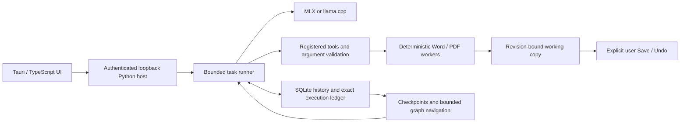

# Architecture and reuse map

- `apps/desktop`: project/chat sidebar, composer, attachments, preview, annotations and native shell. Backend connection credentials stay local.
- `host/localoffice/runtime.py`: task lifecycle and context assembly. Inspect helpers before transplanting; this is research code, not a stable SDK.
- `host/localoffice/providers.py`: local inference adapters. Discovery is not compatibility certification.
- `host/localoffice/storage.py`: project state and transactional artifact history. Use current hashes and execution receipts as authority.
- `host/localoffice/word`: contracts, source references, creation proposals, revisions, drafting and deterministic dispatch.
- `workers/openxml`: .NET / Open XML SDK operations. The model selects tools; the worker performs mutations.
- `workers/fields`: LibreOffice Java field-update helper, isolated from authoritative DOCX mutation during rendering.
- `packages/contracts`: extension contracts. `SKILL.md` import does not imply arbitrary Claude/Codex skill compatibility or script execution.
- `tests`: deterministic and integration checks; some require optional workers or a local tokenizer.
- `scripts`: original research scripts. Some depend on private historical reports or temporary state that is deliberately excluded. Use the supported commands in REPRODUCE.md first.

The [reuse guide](REUSE.md) maps each reusable component to source, tests and limitations. The [accuracy report](ACCURACY_EXPERIMENTS.md) separates engineering safeguards from observed model outcomes.

## Memory authority

Durable history and exact receipts survive context recycling. Summaries/checkpoints and graph neighbourhoods help retrieve relevant work; they do not prove a write occurred or replace original files. Chat scope limits context while project artifacts can be shared. Do not replace the ledger with a knowledge graph or treat generated summaries as authoritative state.

## Reliability layers

Native model template/parser; constrained tool payloads; a compact active tool set and lazily loaded skill guidance; deterministic validation, bounded retries and revision/freshness checks. All four layers are useful protections, but the experiment did not establish semantic reliability.

## Boundaries

Operate on disposable example projects during evaluation. Apply/Save changes files only after user action. Imported skills and local attachments remain untrusted inputs. Local execution is not an OS security sandbox. Review the code and dependencies before exposing the host beyond loopback or granting access to valuable folders.
